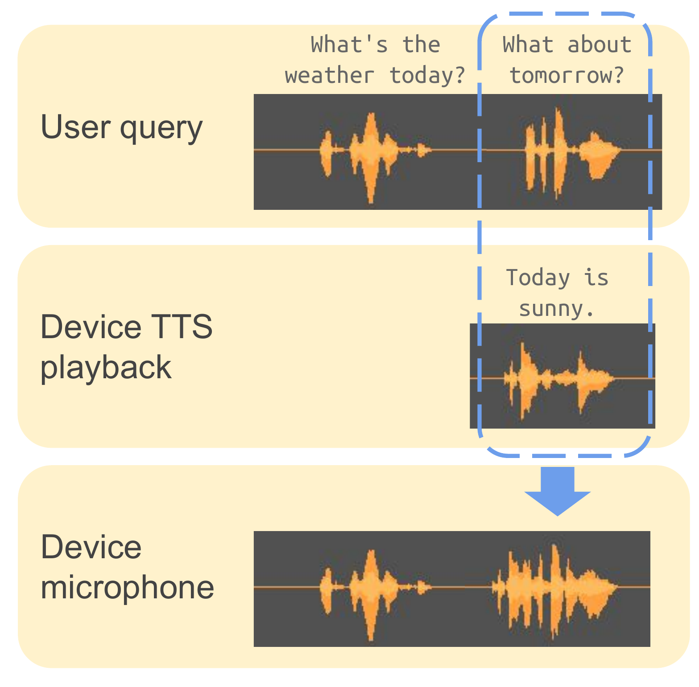
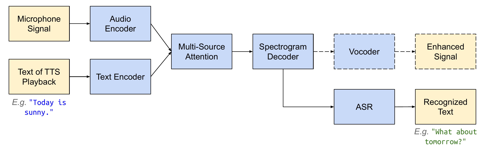
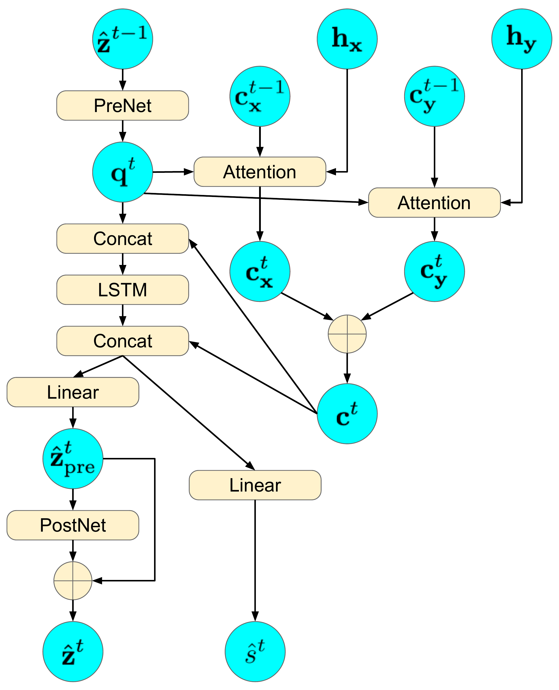
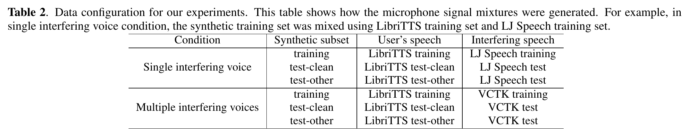
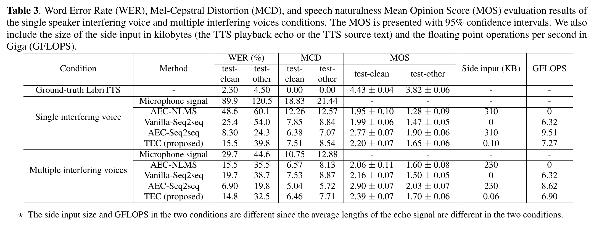

# Textual Echo Cancellation (TEC)

**This is not an officially supported Google product.**

[](https://github.com/wq2012/tec/actions/workflows/pythonapp.yml)
[](https://huggingface.co/spaces/wq2012/tec)
[](https://huggingface.co/wq2012/tec_single_interfering)
[](https://pypi.org/project/textual-echo-cancellation/)
[](https://pypi.org/project/textual-echo-cancellation/)
[](https://www.pepy.tech/projects/textual-echo-cancellation)

## Introduction

This repository provides a standalone, open-source Python reproduction of
**Textual Echo Cancellation (TEC)** based on the IEEE SLT 2021 paper:

> **Textual Echo Cancellation**
> *Shaojin Ding, Ye Jia, Ke Hu, Quan Wang*
> Paper: [https://arxiv.org/pdf/2008.06006](https://arxiv.org/pdf/2008.06006) | Interactive Demo: [Hugging Face Space (`wq2012/tec`)](https://huggingface.co/spaces/wq2012/tec) | Audio Samples: [https://google.github.io/speaker-id/publications/TEC/](https://google.github.io/speaker-id/publications/TEC/)

> [!NOTE]
> **Open-Source Reproduction Notice**: This library is an independent
> open-source reproduction of the published paper above. It does **not** use the
> exact same codebase as the original paper, which was developed on top of
> Google's internal software infrastructure (including internal training
> frameworks, acoustic frontends, room simulators, WaveRNN vocoders, and ASR
> evaluation pipelines). Instead, all modules in this repository are newly
> implemented from scratch using open-source [`lingvo`](https://github.com/tensorflow/lingvo)
> and `tensorflow` to make the architecture, data preparation, training,
> evaluation, and TFLite export accessible to the broader research community.

When a user speaks to a smart speaker or voice-enabled device while the device
is playing back a Text-to-Speech (TTS) response, the microphone captures a
reverberant mixture of the user's speech and the device's TTS playback.
Classical Acoustic Echo Cancellation (AEC) requires streaming the full
high-bandwidth TTS reference waveform to the echo canceller. **Textual Echo
Cancellation (TEC)** instead uses the lightweight **text transcript of the
interfering TTS prompt** (< 1 KB) as a side input to a multi-source attention
sequence-to-sequence neural network, canceling the interfering TTS echo and
reconstructing the clean user speech spectrogram and waveform.

<p align="center">
  
  &nbsp;&nbsp;&nbsp;
  
</p>

---

## Features

- **Complete Model Suite**:
  - `TecModel`: Multi-source sequence-to-sequence model taking noisy/reverberant
    speech (`SpeechEncoderV1`) and interfering TTS text (`TtsEncoderV2`) with
    `MultiSourceFbeDecoderV1` (`GmmMonotonicAttention` or `AdditiveAttention`).
  - `AecModel` (`AEC-Seq2seq`): Neural baseline taking noisy/reverberant speech
    and clean reference TTS audio with dual speech encoders and multi-source
    attention.
  - `VanillaSeq2SeqModel` (`NoSideInput`): Single-source sequence-to-sequence
    speech enhancement baseline without side input.
  - `NlmsAec` (`AEC-NLMS`): Classical Normalized Least Mean Squares adaptive
    filter baseline.
- **Standalone Lingvo Implementation**: Built on open-source
  [`lingvo`](https://github.com/tensorflow/lingvo) and `tensorflow`, with zero
  dependencies on proprietary internal libraries.

<p align="center">
  
</p>

- **End-to-End Pipelines & CLI Scripts**:
  - **Dataset Preparation** (`scripts/prepare_data.py`): Pairs clean speech
    (LibriTTS) with longer interfering TTS utterances (LJSpeech / VCTK),
    simulates room impulse response (RIR) reverberation, mixes at a target SNR
    (default 0 dB), pads trailing zeros, and writes `TFRecord` datasets.
  - **Model Training** (`scripts/train.py`): Trains any registered Lingvo
    configuration (`TecSingleInterfering`, `TecMultiInterfering`,
    `AecSingleInterfering`, `NoSideInputSingleInterfering`, etc.).
  - **Inference & Waveform Synthesis** (`scripts/inference.py`): Predicts
    enhanced log-Mel spectrograms and synthesizes 24 kHz waveforms via
    Griffin-Lim phase reconstruction (`WaveformProcessor`).
  - **Evaluation** (`scripts/evaluate.py`): Computes 13-MFCC Mel Cepstral
    Distortion (MCD) with Dynamic Time Warping (DTW), punctuation-normalized
    Word Error Rate (WER), and model FLOPS / side-input bandwidth.
  - **TFLite Export** (`scripts/export_tflite.py`): Exports trained models to
    `.tflite` FlatBuffer format (with optional dynamic range quantization) and
    validates on-device execution with `tf.lite.Interpreter`.

---

## Installation

Install from PyPI:

```bash
pip3 install textual-echo-cancellation
```

Or install from source:

```bash
git clone https://github.com/wq2012/tec.git
cd tec
pip3 install -r requirements.txt
pip3 install -e .
```

---

## Quickstart

### 1. Prepare Training & Evaluation Datasets

<p align="center">
  
</p>

You can prepare a `TFRecord` dataset from CSV manifests (`utt_id,wav_path,transcript`)
of clean speech (e.g., [LibriTTS](http://www.openslr.org/60/)) and interfering
TTS speech (e.g., [LJSpeech](https://keithito.com/LJ-Speech-Dataset/) or
[VCTK](https://datashare.ed.ac.uk/handle/10283/3443)), or generate a synthetic
dataset for testing:

```bash
# Generate a synthetic TFRecord dataset for quick testing:
python3 scripts/prepare_data.py \
  --generate_synthetic \
  --num_synthetic 16 \
  --snr_db 0.0 \
  --reverb_rt60 0.25 \
  --output_tfrecord /tmp/tec_data/train.tfrecord

# Or prepare from LibriTTS + LJSpeech CSV manifests:
python3 scripts/prepare_data.py \
  --clean_manifest_csv /path/to/libritts_train.csv \
  --interfering_manifest_csv /path/to/ljspeech_train.csv \
  --snr_db 0.0 \
  --reverb_rt60 0.25 \
  --output_tfrecord /tmp/tec_data/train.tfrecord
```

### 2. Train the Model

```bash
python3 scripts/train.py \
  --model TecSingleInterfering \
  --train_file_pattern "/tmp/tec_data/train.tfrecord" \
  --logdir /tmp/tec_checkpoints \
  --max_steps 100 \
  --batch_size 4 \
  --learning_rate 1e-3
```

Available `--model` configurations:
- `TecSingleInterfering`: TEC model (speech + TTS text) for single-speaker TTS
  interference (LibriTTS + LJSpeech).
- `TecMultiInterfering`: TEC model (speech + TTS text) for multi-speaker TTS
  interference (LibriTTS + VCTK).
- `AecSingleInterfering` / `AecMultiInterfering`: `AEC-Seq2seq` baseline
  (speech + TTS reference audio).
- `NoSideInputSingleInterfering` / `NoSideInputMultiInterfering`:
  `Vanilla-Seq2seq` baseline (speech mixture only).

### 3. Run Inference

```bash
python3 scripts/inference.py \
  --model TecSingleInterfering \
  --checkpoint_path /tmp/tec_checkpoints/model.ckpt-100 \
  --mixed_wav /path/to/mixed_input.wav \
  --interfering_text "currently in mountain view it is 72 degrees" \
  --output_wav /tmp/enhanced_clean.wav
```

### 4. Evaluate MCD, WER, and Model Complexity

```bash
python3 scripts/evaluate.py \
  --ref_wav /path/to/clean_reference.wav \
  --pred_wav /tmp/enhanced_clean.wav \
  --ref_transcript "Turn off the bedroom lights!" \
  --hyp_transcript "turn off the bedroom lights" \
  --print_complexity
```

### 5. Export to TensorFlow Lite (`.tflite`)

```bash
python3 scripts/export_tflite.py \
  --model TecSingleInterfering \
  --checkpoint_path /tmp/tec_checkpoints/best.ckpt \
  --output_tflite /tmp/tec_model.tflite \
  --num_frames 200 \
  --text_length 100 \
  --decode_steps 200 \
  --quantize \
  --verify
```

---

## Published Paper Reference Results

For reference, **Table 3** of the original paper
([arXiv:2008.06006v4](https://arxiv.org/pdf/2008.06006)) reported the following
results using Google's internal speech infrastructure on 24 kHz LibriTTS mixed
at 0 dB SNR with reverberant LJ Speech (single interfering voice) and VCTK
(multiple interfering voices):

| Condition | Method | WER (%) test-clean ↓ | WER (%) test-other ↓ | MCD (dB) test-clean ↓ | MCD (dB) test-other ↓ | MOS test-clean ↑ | MOS test-other ↑ | Side input (KB) ↓ | GFLOPS ↓ |
| :--- | :--- | :---: | :---: | :---: | :---: | :---: | :---: | :---: | :---: |
| **Ground-truth LibriTTS** | - | 2.30 | 4.50 | 0.00 | 0.00 | 4.43 ± 0.04 | 3.82 ± 0.06 | - | - |
| **Single interfering voice** *(LibriTTS + LJ Speech)* | Microphone signal | 89.9 | 120.5 | 18.83 | 21.44 | - | - | - | - |
| | AEC-NLMS | 48.6 | 60.1 | 12.26 | 12.57 | 1.95 ± 0.10 | 1.28 ± 0.09 | 310 | 0 |
| | Vanilla-Seq2seq | 25.4 | 54.0 | 7.85 | 8.84 | 1.99 ± 0.06 | 1.47 ± 0.05 | 0 | 6.32 |
| | AEC-Seq2seq | 8.30 | 24.3 | 6.38 | 7.07 | 2.77 ± 0.07 | 1.90 ± 0.06 | 310 | 9.51 |
| | **TEC (proposed)** | **15.5** | **39.8** | **7.51** | **8.54** | **2.20 ± 0.07** | **1.65 ± 0.06** | **0.10** | **7.27** |
| **Multiple interfering voices** *(LibriTTS + VCTK)* | Microphone signal | 29.7 | 44.6 | 10.75 | 12.88 | - | - | - | - |
| | AEC-NLMS | 15.5 | 35.5 | 6.57 | 8.13 | 2.06 ± 0.11 | 1.60 ± 0.08 | 230 | 0 |
| | Vanilla-Seq2seq | 19.7 | 38.7 | 7.53 | 8.87 | 2.16 ± 0.07 | 1.50 ± 0.05 | 0 | 6.32 |
| | AEC-Seq2seq | 6.90 | 19.8 | 5.04 | 5.72 | 2.90 ± 0.07 | 2.03 ± 0.07 | 230 | 8.62 |
| | **TEC (proposed)** | **14.8** | **32.5** | **6.46** | **7.71** | **2.39 ± 0.07** | **1.70 ± 0.06** | **0.06** | **6.90** |

> **⋆ Note (Table 3 & Section 3.4–3.5 of the paper)**:
> - The side input size and GFLOPS in the two conditions are different since the average lengths of the echo signal are different in the two conditions (~7 seconds per utterance in LJ Speech vs. ~2 seconds per utterance in VCTK).
> - In the paper, models were trained on 2×2 TPU slices with a global batch size of 32 using the Adam optimizer (`beta1=0.9, beta2=0.999, eps=1e-6`) and an initial learning rate of `1e-4` exponentially decaying to `1e-5` after 50,000 iterations.

<p align="center">
  
</p>

### Interactive Demo & Pretrained Models on Hugging Face

- **Interactive Demo (Hugging Face Space)**: **[`https://huggingface.co/spaces/wq2012/tec`](https://huggingface.co/spaces/wq2012/tec)** — Upload any microphone mixture audio file and enter the interfering TTS text to run Textual Echo Cancellation and compare Automatic Speech Recognition (ASR) results before and after TEC.

We also provide pretrained checkpoints (`best.ckpt.*`) and quantized TensorFlow Lite
models (`model.tflite`) on Hugging Face for both conditions and all neural
architectures (**TEC**, **AEC-Seq2seq**, and **Vanilla-Seq2seq**):

- **Single Interfering Voice (`LibriTTS + LJSpeech`)**:
  - **TEC (proposed)**: [`wq2012/tec_single_interfering`](https://huggingface.co/wq2012/tec_single_interfering)
  - **AEC-Seq2seq**: [`wq2012/aec_single_interfering`](https://huggingface.co/wq2012/aec_single_interfering)
  - **Vanilla-Seq2seq**: [`wq2012/vanilla_seq2seq_single_interfering`](https://huggingface.co/wq2012/vanilla_seq2seq_single_interfering)
- **Multiple Interfering Voices (`LibriTTS + VCTK`)**:
  - **TEC (proposed)**: [`wq2012/tec_multi_interfering`](https://huggingface.co/wq2012/tec_multi_interfering)
  - **AEC-Seq2seq**: [`wq2012/aec_multi_interfering`](https://huggingface.co/wq2012/aec_multi_interfering)
  - **Vanilla-Seq2seq**: [`wq2012/vanilla_seq2seq_multi_interfering`](https://huggingface.co/wq2012/vanilla_seq2seq_multi_interfering)

```python
import os
import numpy as np
from huggingface_hub import snapshot_download
from tec import inference

# Download pretrained TecSingleInterfering model from Hugging Face
model_dir = snapshot_download(repo_id="wq2012/tec_single_interfering")
result = inference.run_inference_on_wav(
    model_name="TecSingleInterfering",
    mixed_wav_path="/path/to/mixed_input.wav",
    interfering_text="currently in mountain view it is 72 degrees",
    checkpoint_path=os.path.join(model_dir, "best.ckpt"),
    output_wav_path="/tmp/enhanced_clean.wav",
)

# Or run on-device inference with the quantized TensorFlow Lite model
tflite_out = inference.run_tflite_inference(
    tflite_path=os.path.join(model_dir, "model.tflite"),
    mixed_mel=np.zeros((100, 128), dtype=np.float32),
    interfering_text="currently in mountain view it is 72 degrees",
)
```

Using the standalone data preparation (`scripts/prepare_data.py`), training
(`scripts/train.py`), and evaluation (`scripts/evaluate.py`) pipelines in this
repository on the open-source **LibriTTS** (`train-clean-100`, `dev-clean`,
`test-clean`, `test-other`), **LJSpeech-1.1** (train/dev/test splits), and
**VCTK-0.92** (per-speaker train/dev/test splits across 109 speakers) datasets
at 24 kHz (400 training utterances and 100 validation utterances per condition,
mixed at 0 dB SNR with synthetic room impulse responses at RT60 = 0.25 s,
trained for 500 steps with validation-loss early stopping `best.ckpt`,
`batch_size=8, learning_rate=1e-3`, and evaluated with local
`Qwen3-ASR-0.6B-F16` via `audio.cpp` across N = 100 utterances per test split
with 10,000-resample non-parametric bootstrap 95% confidence intervals):

| Condition | Method | Hugging Face Model | WER (%) test-clean ↓ | WER (%) test-other ↓ | MCD (dB) test-clean ↓ | MCD (dB) test-other ↓ | Side Input test-clean (KB) ↓ | Avg Complexity (GFLOPS) ↓ |
| :--- | :--- | :--- | :---: | :---: | :---: | :---: | :---: | :---: |
| **Ground-truth LibriTTS** | `GroundTruth` | — | 3.52 (34/965) [2.09, 5.12] | 5.19 (52/1001) [3.56, 7.06] | 0.00 | 0.00 | 0.000 | 0.00 |
| **Single interfering voice** *(LibriTTS + LJSpeech)* | `MicrophoneSignal` | — | 30.67 (296/965) [22.83, 39.70] | 56.94 (570/1001) [48.04, 66.46] | 7.19 [6.81, 7.60] | 8.35 [7.89, 8.80] | 0.000 | 0.00 |
| | `NlmsAec` (AEC-NLMS) | — | 58.86 (568/965) [51.17, 67.37] | 79.92 (800/1001) [73.98, 86.40] | 7.84 [7.54, 8.16] | 9.12 [8.70, 9.54] | 146.667 | 0.02 |
| | `NoSideInputSingleInterfering` (Vanilla-Seq2seq) | [`wq2012/vanilla_seq2seq_single_interfering`](https://huggingface.co/wq2012/vanilla_seq2seq_single_interfering) | 30.88 (298/965) [24.11, 38.88] | 58.54 (586/1001) [49.60, 67.69] | 8.34 [8.10, 8.58] | 9.27 [8.96, 9.58] | 0.000 | 2.79 |
| | `AecSingleInterfering` (AEC-Seq2seq) | [`wq2012/aec_single_interfering`](https://huggingface.co/wq2012/aec_single_interfering) | 9.12 (88/965) [6.59, 11.92] | 21.68 (217/1001) [17.73, 26.00] | 6.62 [6.44, 6.80] | 7.20 [6.96, 7.45] | 146.667 | 4.15 |
| | **`TecSingleInterfering` (TEC)** | **[`wq2012/tec_single_interfering`](https://huggingface.co/wq2012/tec_single_interfering)** | **20.31 (196/965) [15.19, 26.71]** | **38.06 (381/1001) [31.47, 45.35]** | **7.00 [6.72, 7.29]** | **7.76 [7.40, 8.15]** | **0.048** | **3.08** |
| **Ground-truth LibriTTS (Multi split)** | `GroundTruth` | — | 3.97 (37/931) [2.58, 5.48] | 6.56 (65/991) [4.69, 8.65] | 0.00 | 0.00 | 0.000 | 0.00 |
| **Multiple interfering voices** *(LibriTTS + VCTK)* | `MicrophoneSignal` | — | 20.30 (189/931) [14.89, 26.57] | 40.16 (398/991) [33.27, 47.98] | 5.48 [5.14, 5.85] | 5.88 [5.51, 6.27] | 0.000 | 0.00 |
| | `NlmsAec` (AEC-NLMS) | — | 34.48 (321/931) [29.08, 40.35] | 55.70 (552/991) [49.49, 62.39] | 6.89 [6.61, 7.18] | 7.68 [7.29, 8.08] | 136.043 | 0.02 |
| | `NoSideInputMultiInterfering` (Vanilla-Seq2seq) | [`wq2012/vanilla_seq2seq_multi_interfering`](https://huggingface.co/wq2012/vanilla_seq2seq_multi_interfering) | 30.83 (287/931) [24.72, 37.89] | 50.76 (503/991) [43.86, 58.31] | 8.57 [8.34, 8.81] | 8.76 [8.51, 9.01] | 0.000 | 2.76 |
| | `AecMultiInterfering` (AEC-Seq2seq) | [`wq2012/aec_multi_interfering`](https://huggingface.co/wq2012/aec_multi_interfering) | 9.77 (91/931) [7.40, 12.39] | 24.52 (243/991) [20.60, 28.74] | 5.93 [5.74, 6.15] | 6.16 [5.92, 6.41] | 136.043 | 4.03 |
| | **`TecMultiInterfering` (TEC)** | **[`wq2012/tec_multi_interfering`](https://huggingface.co/wq2012/tec_multi_interfering)** | **20.09 (187/931) [16.11, 24.53]** | **39.25 (389/991) [33.79, 45.29]** | **6.52 [6.34, 6.70]** | **6.84 [6.60, 7.09]** | **0.035** | **2.98** |

#### Text-Content Sensitivity Ablation (N = 100 per split)

To verify that `TtsEncoderV2` actively exploits the semantic and phonetic content of the interfering TTS transcript rather than acting as a content-independent bias, we evaluate `TecSingleInterfering` and `TecMultiInterfering` under three text side-input conditions on the exact same audio mixtures:

| Split | Side-Input Condition | WER (%) ↓ | MCD (dB) ↓ | ΔWER vs. `matched` | Paired p-value (Bootstrap / Wilcoxon) |
| :--- | :--- | :---: | :---: | :---: | :---: |
| `single_test_clean` (`TecSingleInterfering`) | **`matched` (true TTS transcript)** | **20.31% (196/965)** | **7.00 dB** | — | — |
| | `shuffled` (mismatched transcript) | 30.67% (296/965) | 8.34 dB | +10.36% | p < 0.0001 / p = 1.94e-05 |
| | `empty` (no text) | 31.09% (300/965) | 8.61 dB | +10.78% | p < 0.0001 / p = 1.75e-05 |
| | `Vanilla-Seq2seq` (`NoSideInputSingleInterfering`) | 30.88% (298/965) | 8.34 dB | +10.57% | p < 0.0001 / p = 1.28e-04 |
| `multi_test_clean` (`TecMultiInterfering`) | **`matched` (true TTS transcript)** | **20.09% (187/931)** | **6.52 dB** | — | — |
| | `shuffled` (mismatched transcript) | 28.79% (268/931) | 8.53 dB | +8.70% | p = 0.0002 / p = 8.30e-04 |
| | `empty` (no text) | 29.97% (279/931) | 8.59 dB | +9.88% | p < 0.0001 / p = 6.32e-05 |
| | `Vanilla-Seq2seq` (`NoSideInputMultiInterfering`) | 30.83% (287/931) | 8.57 dB | +10.74% | p < 0.0001 / p = 3.10e-05 |

#### Input SNR Ablation on `single_test_clean` (N = 100 mixtures per SNR)

| Input SNR | `MicrophoneSignal` WER / MCD | `NlmsAec` WER / MCD | `Vanilla-Seq2seq` WER / MCD | **`TecSingleInterfering` WER / MCD** | `AecSingleInterfering` WER / MCD |
| :---: | :---: | :---: | :---: | :---: | :---: |
| **+5 dB** | 12.23% / 6.09 dB | 44.04% / 7.29 dB | 14.92% / 7.45 dB | **10.16% / 6.14 dB** | 6.63% / 6.15 dB |
| **0 dB** | 30.67% / 7.19 dB | 58.86% / 7.84 dB | 30.88% / 8.34 dB | **20.31% / 7.00 dB** | 9.12% / 6.62 dB |
| **-5 dB** | 79.07% / 8.26 dB | 79.07% / 8.46 dB | 78.24% / 9.31 dB | **52.23% / 7.87 dB** | 18.86% / 7.34 dB |
| **-10 dB** | 103.21% / 9.20 dB | 94.40% / 9.07 dB | 103.63% / 10.16 dB | **93.89% / 8.63 dB** | 53.06% / 8.11 dB |

---

## Running Unit Tests

To run the full test suite locally:

```bash
bash run_tests.sh
```

---

## Citation

If you find this library useful in your research, please cite the paper:

```bibtex
@inproceedings{ding2021textual,
  title={Textual Echo Cancellation},
  author={Ding, Shaojin and Jia, Ye and Hu, Ke and Wang, Quan},
  booktitle={2021 IEEE Spoken Language Technology Workshop (SLT)},
  pages={653--660},
  year={2021},
  organization={IEEE}
}
```
